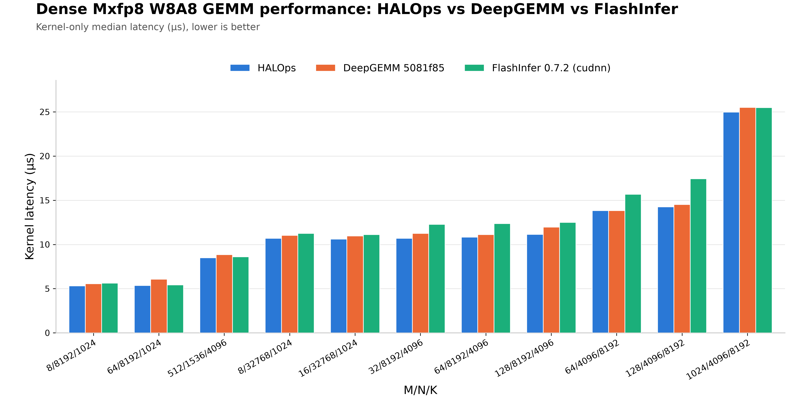
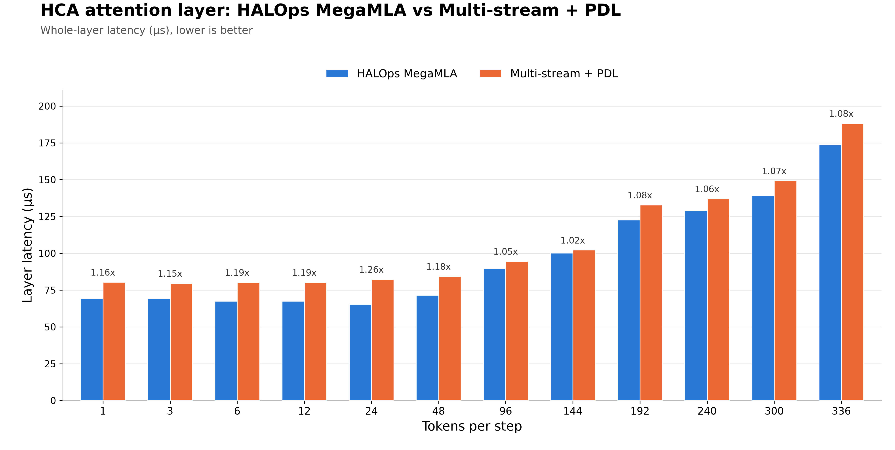

[English](README.md) | 简体中文

<div align="center">

<picture>
  <source media="(prefers-color-scheme: dark)" srcset="docs/images/halops-logo-dark.svg">
  
</picture>

# **H**igh-performance **A**ccelerated **L**LM **Op**erator**s**

[](LICENSE)
[](pyproject.toml)
[](docs/build_guide_CN.md)
[](docs/build_guide_CN.md)
[](pyproject.toml)

</div>

HALOps（High-performance Accelerated LLM Operators）是文心团队开发的大模型推理高性能算子库。算子充分利用 NVIDIA GPU 硬件特性，并配合 PDL、多流 overlap、算子融合与 MegaKernel 等手段压缩 kernel 间的空泡，让计算、访存与通信尽可能满载，服务高吞吐、低时延的推理场景。

[核心能力](#核心能力) | [性能](#性能) | [硬件与软件要求](#硬件与软件要求) | [快速开始](#快速开始) | [文档](https://paddlepaddle.github.io/HALOps/) | [构建指南](docs/build_guide_CN.md) | [Benchmark 指南](benchmark/README.md#简体中文) | [贡献指南](CONTRIBUTING.md#简体中文)

## 核心能力

HALOps 面向 NVIDIA Blackwell（SM100）从零设计，基于 CUTLASS / CuTe 直接使用 tcgen05、TMEM 与 TMA 等新硬件特性，覆盖大模型推理的 Attention、MoE 与 MLA 关键路径。

- **GQA Attention**：支持变长 prefill 与 paged-KV decode，覆盖 BF16 / FP8 KV cache、GQA 与 投机解码 等推理场景，结合 split-KV 并行、自适应规约与前后处理算子融合，在长上下文与小 batch decode 下充分释放 SM100 的算力与带宽。
- **多精度 GEMM**：支持 FP8（MXFP8）与 FP4（NVFP4 / MXFP4）block-scaled GEMM，覆盖 dense、batched 与 MoE grouped 场景，结合超轻量开销的灵活 tile 配置与 pre-mapping tile 调度等策略，在 SM100 架构上取得了全场景业界领先的性能。
- **巨内核稀疏 MLA**：支持 HCA 与 SWA 的高性能巨内核（MegaKernel）稀疏 attention，消除 kernel 调度与中间结果的显存往返开销，并通过 tile 级流水编排掩盖计算与访存开销，进一步提升 GPU 算力利用率。

## 性能
以下数据均在 SM100 架构上测试：MXFP8 Dense GEMM 在部分场景下性能领先 DeepGEMM 与 FlashInfer；MegaMLA 在小并发场景下全面领先多流结合 PDL 的实现方式。

<table>
  <tr>
    <td width="50%"></td>
    <td width="50%"></td>
  </tr>
  <tr>
    <td align="center"><sub>图 1：Dense Mxfp8 W8A8 GEMM 性能对比</sub></td>
    <td align="center"><sub>图 2：HCA attention 层性能对比</sub></td>
  </tr>
</table>

## 硬件与软件要求

| 组件 | 要求 |
| --- | --- |
| GPU | NVIDIA Blackwell SM100 GPU |
| CUDA Toolkit | 13.0 或更高版本，硬件架构 `compute_100f/sm_100f` |
| NVIDIA Driver | 与 CUDA 13.x 兼容的 R580 或更新版本 |
| Python / PyTorch | Python 3.10+；PyTorch 2.13+ |

驱动要求以 [NVIDIA CUDA compatibility matrix](https://docs.nvidia.com/deploy/cuda-compatibility/) 为准；源码构建的完整环境要求见 [构建指南](docs/build_guide_CN.md)。

## 快速开始

### 从 whl 安装

准备好与本机 CUDA 兼容的 CUDA 版 PyTorch 后，直接安装 [HALOps 预编译包](https://www.paddlepaddle.org.cn/packages/stable/cu132/halops/)：

```bash
python -m pip install halops==0.1.0 -f https://www.paddlepaddle.org.cn/packages/stable/cu132/halops/
```

### 从源码构建

需要自行编译时，在仓库根目录执行：

```bash
git submodule update --init --recursive
python -m pip install -r requirements.txt
python -m pip install --no-build-isolation --no-deps -v .
```

开发态安装、wheel 构建、CUDA 路径配置与编译并发控制见 [构建指南](docs/build_guide_CN.md)。

### 验证安装

安装后可通过一个 W8A8-MXFP8 dense GEMM 简单示例验证量化和计算链路，预期输出为 `torch.Size([128, 256]) torch.bfloat16`。

```python
import torch

from halops import dense_gemm, group_wise_quant

M, N, K = 128, 256, 512
a = torch.randn((M, K), device="cuda", dtype=torch.bfloat16)
b = torch.randn((N, K), device="cuda", dtype=torch.bfloat16)

a_fp8, scale_a = group_wise_quant(a, mode="w8a8-mxfp8", use_swizzle=True)
b_fp8, scale_b = group_wise_quant(b, mode="w8a8-mxfp8", use_swizzle=True)
output = torch.empty((M, N), device="cuda", dtype=torch.bfloat16)

dense_gemm(a_fp8, b_fp8, scale_a, scale_b, output, mode="w8a8-mxfp8")
print(output.shape, output.dtype)
```

## 路线图

- **全面的 GEMM 支持矩阵**：覆盖 W4A8、BF16 等类型的 GEMM，打造全量化类型的 GEMM 支持矩阵，满足不同推理性能与效果需求下的选择。
- **更高性能的巨内核方案**：覆盖更多场景的通算融合，以及计算与访存 overlap 的优化方案。
- **小计算规模下的高性能 kernel**：面向小数据规模的推理方案，为小并发下的极限推理速度提供 kernel 底座支撑。

## 如何贡献

开发环境、代码质量、测试要求和提交检查项见 [CONTRIBUTING.md](CONTRIBUTING.md#简体中文)。

## 致谢

HALOps 基于 [CUTLASS](https://github.com/NVIDIA/cutlass) 与 [CuTe](https://github.com/NVIDIA/cutlass/tree/main/include/cute) 构建，感谢 CUTLASS 开发者的工作。同时感谢 [FlashInfer](https://github.com/flashinfer-ai/flashinfer)、[FlashMLA](https://github.com/deepseek-ai/FlashMLA) 与 [DeepGEMM](https://github.com/deepseek-ai/DeepGEMM) 在大模型推理算子上的先行探索，为 HALOps 的设计带来了诸多启发，也为我们验证实现提供了重要参照。

## 许可证

HALOps 使用 [Apache License 2.0](LICENSE)。
